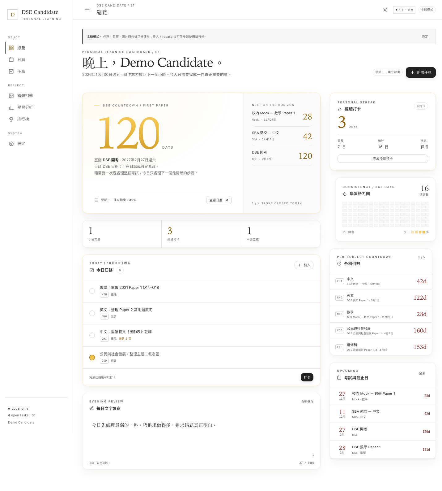

# DSE Candidate — Personal Learning Dashboard

A quiet DSE study dashboard with two modes:

| Mode | What it needs | What works |
| --- | --- | --- |
| **A · Local-only** | Nothing | Calendar, countdowns, tasks, rollover, ICS, local image archive, streak/heatmap, analytics, reflection |
| **B · Firebase Spark** | Six `VITE_FIREBASE_*` values | Everything in A, plus Google login, cross-device Firestore sync, one-click local import, opt-in streak leaderboard, admin-managed official DSE timetable |

The default visual theme is **white-gold**: white/platinum paper, charcoal text, gold for streak/check-in/exam countdown emphasis. The original deep-navy Dream Theater palette is retained as an optional dark theme. Layout, component structure and typography are unchanged; only colour tokens switch.



## What is included

- **FullCalendar** month / week / day / list views.
- **Layered DSE countdowns** — first paper, every subject's next paper, Mock, school exam and SBA.
- **2025 HKEAA timetable base** — finalised written timetable transcribed from the [HKEAA circular](https://www.hkeaa.edu.hk/DocLibrary/Circulars/HKDSE/HKDSE_Finalised_Examination_Timetable_for_2025_Examination.pdf); users can hide system events but cannot edit or delete them. The default DSE year is the next exam year that has not passed (e.g. October 2026 defaults to 2027); later years shift the 2025 dates and are labelled **預估日期，一切以 HKEAA 正式公告為準**.
- **Tasks** — subject label, due date, completion, notes, and idempotent next-day rollover.
- **Days-Matter style custom countdowns** — any user event appears on the dashboard, countdown cards and calendar.
- **ICS** — RFC5545 import/export; VEVENT, VTODO, RRULE, VALARM; official DSE events are included in export.
- **Mistake-photo archive** — multiple compressed WebP images per day, bound to a date and subject, kept in **localStorage only**.
- **Gold streak heatmap** — 365 days, personal only, no public study-detail ranking.
- **Analytics** — per-subject completion, 8-week trend, task-based exam readiness.
- **Daily reflection** — debounced autosave, synced in Mode B.
- **Opt-in leaderboard** — only display name, current streak and total days; default hidden; polled every 60 seconds while the page is visible, with a manual refresh button and no persistent realtime listener.
- **Admin timetable updates** — `admins/{uid}` accounts can replace `systemExams/{year}`; normal users can only hide entries.

## Quick start

```bash
# pnpm is the preferred package manager
corepack enable            # only needed once
pnpm install
cp .env.example .env.local # leave Firebase values empty for Mode A
pnpm dev
```

If pnpm is unavailable, `npm install && npm run dev` works too.

Open <http://localhost:5173>. Use **設定 → 載入示範資料** for a relative-date preview.

```bash
pnpm typecheck
pnpm build
pnpm preview
```

## Mode A / Mode B switch

The switch is purely environmental:

- **All six Firebase values empty** → Mode A. Firebase is not initialized, no Firestore request is made, the UI says `本機模式`, and all data stays in localStorage.
- **All six values filled** → Mode B. The app initializes Firebase, shows Google login, and hydrates Firestore after sign-in.
- A partially filled Firebase config is treated as Mode A rather than half-initialising a broken app.

```dotenv
VITE_FIREBASE_API_KEY=
VITE_FIREBASE_AUTH_DOMAIN=
VITE_FIREBASE_PROJECT_ID=
VITE_FIREBASE_STORAGE_BUCKET=
VITE_FIREBASE_MESSAGING_SENDER_ID=
VITE_FIREBASE_APP_ID=
```

Firestore location must be **asia-east2 (Hong Kong)**. Choose it when creating the database; a Firestore location cannot be changed later without recreating the database.

Never put a service-account JSON, Apple app password, OAuth client secret or any other secret in a `VITE_*` variable. Mode B does not need any of them.

## GitHub Pages deployment

The workflow at [.github/workflows/deploy.yml](.github/workflows/deploy.yml) runs typecheck + build and publishes `dist` with GitHub Pages.

1. Push the repository to GitHub (`.env.local` is ignored and must never be committed).
2. **Settings → Pages → Source: GitHub Actions**.
3. **Settings → Secrets and variables → Actions → Variables** — add all six `VITE_FIREBASE_*` values. Add `VITE_BASE_PATH=/<repo>/` for a project site (omit it, or use `/`, for a user site).
4. Run **Actions → Deploy to GitHub Pages** (or push to `main`).
5. Add `your-name.github.io` (origin only, no repository path) to **Firebase Console → Authentication → Settings → Authorized domains**.

The six `VITE_FIREBASE_*` values are Firebase web identifiers, not secrets; the authorization boundary is `firestore.rules`. Never add a service account or OAuth client secret to Actions Variables.

## One-click local import

On first sign-in, local tasks, events, reflections, settings and verifiable check-ins are **not** silently overwritten. The app merges local-only records into the view and offers **設定 → 跨裝置同步 → 上傳本機資料**.

- Tasks/events/reflections/settings use stable local IDs, so re-import is idempotent.
- A local check-in is imported only if the local data contains a completed task with a matching `completedDate`; otherwise it is counted as skipped.
- Historical local check-ins without a corresponding task are not back-filled, because check-ins must reference a completed task under the security rules.

## Firestore shape

```text
users/{uid}
  displayName, leaderboardOptIn, photoURL, email, createdAt, updatedAt

users/{uid}/tasks/{taskId}
  title, subjectId, dueDate, completed, completedAt, completedDate,
  notes, kind, createdAt, updatedAt, rolledFrom, rolloverCount, source

users/{uid}/events/{eventId}
  uid, title, start, end, allDay, type, subjectId, paper, description,
  rrule, source, externalId, etag, updatedAt, deleted

users/{uid}/checkins/{YYYY-MM-DD}
  date, completedTaskCount, taskId, createdAt, source   (create-only)

users/{uid}/meta/stats
  currentStreak, longestStreak, totalDays, lastCheckinDate, updatedAt

users/{uid}/meta/settings
  dseYear, dseStartDate, dseEndDate, studyStartDate,
  hiddenSystemExamIds, semesterMode, timezone, updatedAt

users/{uid}/reflections/{YYYY-MM-DD}
  date, text, updatedAt

leaderboard/{uid}
  uid, displayName, currentStreak, totalDays, visible,
  writes, windowStart, updatedAt   (writes/windowStart = one-hour rate budget)

systemExams/{year}
  year, source, label, events[], updatedAt   (admin write only)

admins/{uid}
  active: true                               (created manually in console)
```

## Leaderboard and anti-abuse

- Default **opt-in false**; only name + currentStreak + totalDays are public.
- The board is **polled every 60 seconds** only while the leaderboard page is visible, and pauses on `visibilitychange`; a **手動更新** button triggers an immediate one-shot read. There is no `onSnapshot` listener.
- The query is capped at 100 visible documents per poll.
- One check-in document per date; client update/delete of check-ins is denied.
- A check-in must reference a task owned by the same user with `completedDate == date`. Firestore rules use `get()` on that exact task.
- Public metric writes are rate-limited by rules: 20 metered writes per rolling hour (the leaderboard document carries `writes`/`windowStart`; every metered update must increment by exactly one, and an expired window can only reset to one). Visibility changes are exempt so opting out is always instant.
- Leaderboard writes are limited to the user's own document; other users' documents are unreadable if hidden and never writable.
- `admins/{uid}` existence is required to write `systemExams`; normal users can only read and locally hide entries.

This is a social nudge, not an exam-integrity system. A determined user can still mark their own task complete before checking in. See [docs/SECURITY.md](docs/SECURITY.md).

## Project layout

```text
tailwind.config.ts     Single source of truth for light/dark colour tokens
src/components/        Views, calendar, editors, heatmap, leaderboard
src/contexts/          Local-first state + Mode B hydration
src/data/dse2025.ts    2025 HKEAA written timetable + year-shift logic
src/lib/
  cloud.ts             Firestore reads/writes, import, system/admin data
  cloudModeB.ts        Firestore-only check-in transaction + leaderboard sync
  firebase.ts          Optional Firebase init; all-six-empty => Mode A
  systemExams.ts       Official/estimated timetable -> calendar events
  ics.ts               RFC5545 import/export
  images.ts            WebP compression + localStorage quota
  storage.ts           Schema normalization, backup/restore
  theme.ts             light/dark preference, no layout changes
  usage.ts             Rough front-end quota estimate
src/styles/            Tailwind theme variables + hand-authored layout CSS
firestore.rules        Paste directly into Firebase Console
firestore.indexes.json
docs/                  Deployment, security, architecture
worker/                Deferred Mode C prototype; not used by Mode B UI
```

## Verification performed

```bash
pnpm typecheck
pnpm build
```

Headless Chrome smoke-tested:

- Mode A with all Firebase variables empty (no crash, local mode label, no Firestore calls).
- Mode B startup with dummy config (login screen, no crash; real auth needs a real project).
- White-gold default theme and dark theme toggle.
- System DSE event preview, hide-to-local, theme toggle.
- Task and event creation.
- Image compression/upload to localStorage.
- ICS import/export including RRULE, VTODO and VALARM.
- Responsive desktop/mobile layout.

Real Google login, Firestore writes and leaderboard updates require your Firebase project and cannot be fully exercised without your credentials.

## Important limitations

- **Mode B does not include CalDAV / Google Calendar / Cloudflare Worker.** That is deferred Mode C. The `worker/` directory is an inactive prototype and is not referenced by the Mode B UI.
- **ICS is a format, not a sync protocol.** Import/export is a snapshot; read-only subscriptions are one-way.
- **Images never go to Firebase Storage** in this version; localStorage is roughly 5 MB. Export a JSON backup before clearing browser data.
- **The DSE database is a study aid.** 2025 is the transcribed official base; later years are estimates and must be checked against HKEAA. The app does not claim official status for shifted dates.
- **Rules cannot compute a streak.** The client computes and writes its own public streak; rules constrain ownership, field shape, one check-in per day and a 20-per-hour public metric write budget, not mathematical correctness.
- **Admin access is manual.** Create `admins/{your-auth-uid}` in Firestore Console; never create it from the public client.

## Docs

- [Deployment: Firebase Spark, asia-east2, GitHub Pages](docs/DEPLOYMENT.md)
- [Architecture: Mode A/B, sync flow, data model](docs/ARCHITECTURE.md)
- [Security: rules, privacy, anti-abuse, quota](docs/SECURITY.md)
- [Deferred Mode C: CalDAV / Google Calendar notes](docs/CALDAV.md)

## License

MIT. See [LICENSE](LICENSE).
