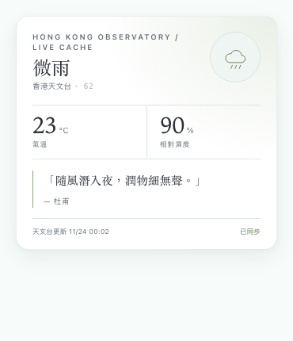

# HKO weather cache



## What it does

The dashboard shows a small, embeddable weather card backed by the Hong Kong
Observatory `rhrread` open-data endpoint:

```text
https://data.weather.gov.hk/weatherAPI/opendata/weather.php?dataType=rhrread&lang=tc
```

The browser **never** calls HKO. It only listens to the Firestore document:

```text
weather/current
```

That avoids CORS, hides the request pattern, and keeps the public API call
volume to one request per 30-minute backend run (plus retries only on failure).

## Runtime paths

| Plan | Scheduler | Entry point |
| --- | --- | --- |
| Spark (current project) | GitHub Actions `*/30 * * * *` | `scripts/weather-sync/sync.js` |
| Blaze | Cloud Functions v2 `every 30 minutes` | `functions/weather.js` → `syncWeather` |

Both paths share the pure logic in `functions/weather-core.js` and the quote
table in `functions/weatherQuotes.json`.

GitHub Actions schedules are best-effort and can be delayed. If exact 30-minute
freshness matters, use the Cloud Functions path or another scheduler.

## Cached document

`weather/current` contains:

| Field | Meaning |
| --- | --- |
| `condition` | Official HKO icon caption, e.g. `微雨`, `多雲`, `雷暴` |
| `conditionCode` | HKO icon code (50–93) |
| `category` | Quote group key (`sunny`, `cloudy`, `overcast`, `lightRain`, `heavyRain`, `windy`, `fog`, `cold`, `hot`, `thunder`) |
| `temperature` | Celsius reading, normally from 香港天文台 station |
| `temperatureUnit` | `C` |
| `temperaturePlace` | Station used for temperature |
| `humidity` | Relative humidity percent, normally from 香港天文台 station |
| `humidityUnit` | `percent` |
| `humidityPlace` | Station used for humidity |
| `quoteText` | Randomly selected quote for this weather category |
| `quoteSource` | `汪曾祺`, `史鐵生`, or a poetry author |
| `weatherUpdateTime` | HKO `updateTime` |
| `iconUpdateTime` | HKO icon update time |
| `fetchedAt` | Backend success timestamp (ISO) |
| `lastAttemptAt` | Last attempt, success or failure |
| `lastError` | Last failure message; empty on success |
| `stale` | `true` when the latest attempt failed and old data was retained |
| `source` | `hko-rhrread` |
| `lang` | `tc` |

When a fetch fails after three attempts:

1. The previous document is **not** overwritten.
2. Only `lastAttemptAt`, `lastError`, `stale`, and `source` are merged.
3. The frontend keeps the old condition, readings, and quote.
4. The card shows `天氣資料更新中` while retaining the previous content.

If there has never been a successful fetch, the card shows the same message
without inventing placeholder weather.

## Official condition text

`rhrread` returns an `icon` code but no free-text `weather` field. The backend
maps the icon code to the official HKO icon caption from:

<https://www.weather.gov.hk/textonly/v2/explain/wxicon_c.htm>

For example `62 → 微雨`, `64 → 大雨`, `65 → 雷暴`, `61 → 密雲`.

## Quotes

The quote table is `functions/weatherQuotes.json`, grouped by weather category.
Every record is exactly:

```json
{ "text": "…", "source": "汪曾祺" }
```

The backend picks a random record in the current category and avoids repeating
the immediately previous quote when the category has more than one record.

## Deploy — Spark path (GitHub Actions)

1. Add the service-account JSON as the repository secret
   `FIREBASE_SERVICE_ACCOUNT` (same secret as the iCal sync).
2. Publish `firestore.rules` so signed-in clients can read `weather/current`.
3. Run **Actions → Weather cache sync → Run workflow** once.
4. Confirm `weather/current` has `stale: false`, `fetchedAt`, and a quote.

The workflow is `.github/workflows/weather-sync.yml`.

## Deploy — Blaze path (Cloud Function)

```bash
firebase deploy --only functions:syncWeather --config firebase.functions.json
```

The function is `asia-east1`, `every 30 minutes`, `Asia/Hong_Kong`, 256 MiB,
60-second timeout. It uses the same Firestore document and the same Admin SDK
permissions. Do not enable both schedulers at the same time.

## Rules

`firestore.rules` allows signed-in reads and denies all browser writes:

```text
match /weather/{docId} {
  allow read: if signedIn();
  allow write: if false;
}
```

Cloud Functions and GitHub Actions use a service account, so they bypass rules.
The service account needs `roles/datastore.user` (already used by the iCal
runner).

## Frontend

`src/components/WeatherCard.tsx` is standalone and can be embedded anywhere:

```tsx
<WeatherCard />
```

It listens to `weather/current` via Firestore `onSnapshot`; there is no HKO URL
or polling code in the browser bundle.
